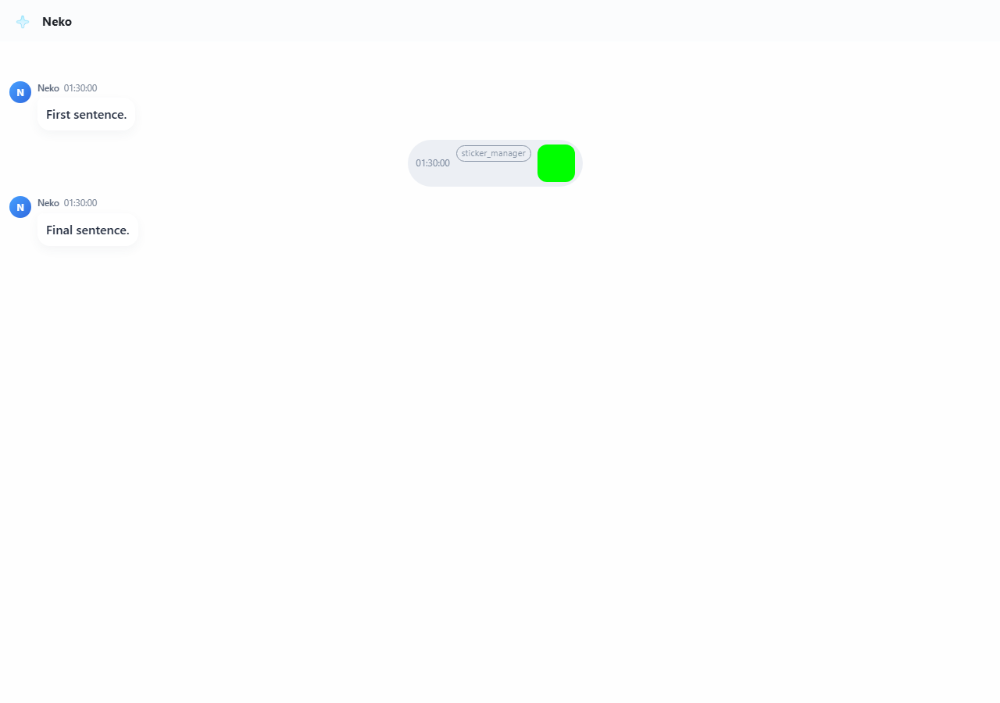
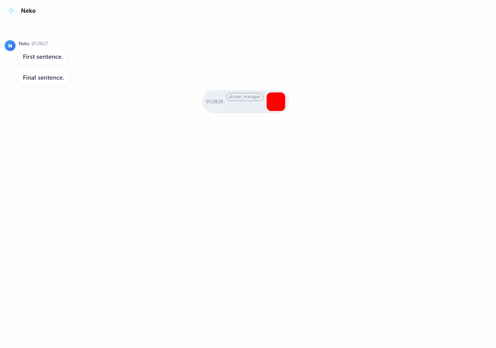
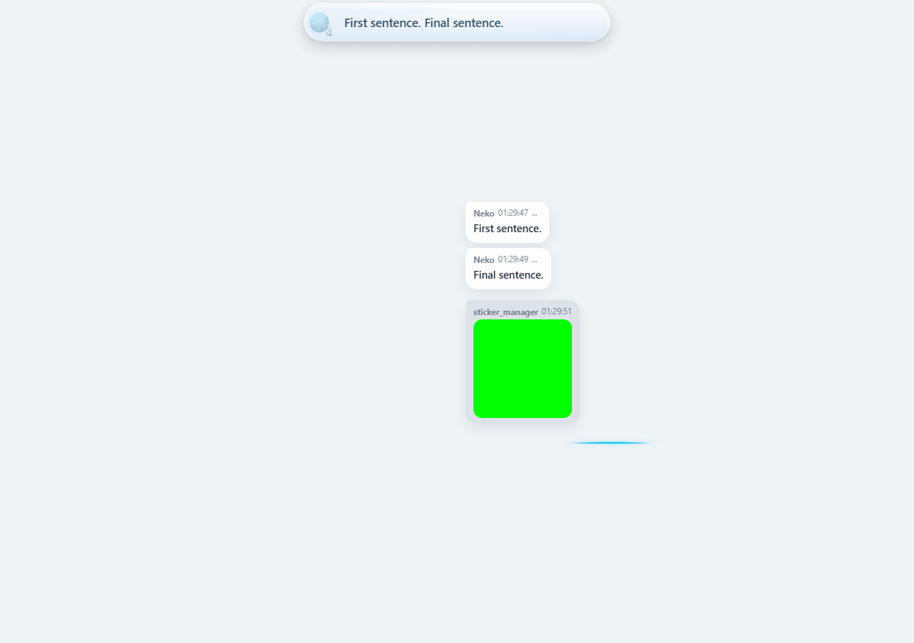

# Original Reply Tail: UI Evidence

These screenshots come from a controlled Chromium fixture using the host's
actual React chat renderer, current chat adapter, reply-tail controller and
sentence queue. They contain synthetic dialogue and an animated red/green GIF.
They are not screenshots of the user's conversation or a Steam installation.

Host implementation: `45d524ea74101511607b5faacb8ef924b8391407`.
Upstream base: `b0abe64c39e10588a9bd127eca133ddfc2fd1e7e`.
Run date: 2026-10-11, Asia/Shanghai.

The evidence branch is separate from the implementation PR so screenshots do
not become runtime assets or add binary files to the host's source diff.

## Immediate Path Reference

The retained ordinary immediate path places the image between the first and
final sentences. This fixture demonstrates the previous sending behavior;
it is not a historical Steam recording.



## Opt-In Original Reply Tail

The image appears after the original final sentence.



In compact mode, the controller observes the actual final caption characters
before releasing the image into the existing chat history area.



## Reproduction

Use the implementation branch, build `frontend/react-neko-chat`, and provide
the build directory and an animated GIF to the browser harness:

```powershell
$env:NEKO_CHAT_BUILD='<built static/react/neko-chat directory>'
$env:NEKO_TAIL_GIF='<animated GIF fixture path>'
$env:NEKO_TAIL_EVIDENCE='<output directory>'
node tests/frontend/reply_tail_browser.cjs
```

The harness requires Playwright and Chromium. Its JSON result covers full and
compact chat, merged and segmented text, desktop and mobile viewports, closed
history, a fast next turn, duplicate packets and the ordinary immediate path.
Success requires real image pixels and changing GIF frames, not just DOM nodes.
